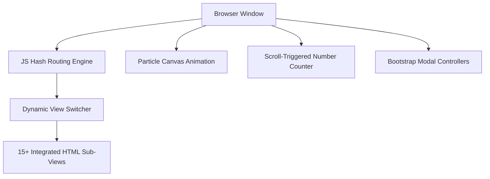

<div align="center">

  <!-- Animated Header Canvas Banner -->
  

  <br>

  <!-- Animated Typing Header -->
  <a href="https://git.io/typing-svg">
    
  </a>

  <br><br>

  <!-- Dynamic Animated Tech Badges -->
  <a href="#-technology-stack">
    
    
    
    
    
  </a>

</div>

---

## ⚡ Key Features & Experience

<div align="center">

```
  ┌─────────────────────────────────────────────────────────────────┐
  │  🚀 Hash Router  │  ✨ Particle Canvas  │  📱 Fully Responsive   │
  ├─────────────────────────────────────────────────────────────────┤
  │  📊 Animated Counter  │  📝 Live Application  │  🎓 Result Search│
  └─────────────────────────────────────────────────────────────────┘
```

</div>

<table>
  <tr>
    <td width="50%">
      <h3>🚀 Instant Route Transition</h3>
      <p>Zero full-page reloads. Uses native HTML5 <code>hashchange</code> events to switch instantly between 15+ sub-page views.</p>
    </td>
    <td width="50%">
      <h3>✨ Interactive Canvas Background</h3>
      <p>Features an animated HTML5 particle grid inside the hero carousel that responds dynamically to mouse movement.</p>
    </td>
  </tr>
  <tr>
    <td width="50%">
      <h3>📊 Animated Metrics Counter</h3>
      <p>Scroll-triggered numerical counter highlighting university achievements (<i>50,000+ Alumni, 100+ Programs, 98% Placements</i>).</p>
    </td>
    <td width="50%">
      <h3>📝 Interactive Modals & Forms</h3>
      <p>Equipped with functional slide-in modals for <b>Online Admissions</b> and instant <b>Semester Result Roll-Number Verification</b>.</p>
    </td>
  </tr>
</table>

---

## 🗺️ Route Navigation Index

<details open>
<summary><b>🔍 Click to Expand / Collapse Route Navigation Index</b></summary>
<br>

### 🏢 Main & Institutional Views
| Route Hash | Description | Status |
| :--- | :--- | :---: |
| `#home` | University Main Landing, Particle Hero & Cards | `🟢 Active` |
| `#history` | Legacy, Accreditation & Historical Overview | `🟢 Active` |
| `#vision` | Global Vision & Strategic Goals | `🟢 Active` |
| `#mission` | Core Mission & Educational Objectives | `🟢 Active` |
| `#iqac` | Internal Quality Assurance Cell Framework | `🟢 Active` |
| `#approvals` | UGC, AICTE, PCI & Govt Accreditations | `🟢 Active` |
| `#priority-trust` | 25+ Years Group Legacy & Financial Aid | `🟢 Active` |
| `#press-release` | News Outlets & Media Coverage | `🟢 Active` |
| `#faq` | Frequently Asked Questions Accordion | `🟢 Active` |

### 📚 Academic Schools
| Route Hash | Department / Discipline | Programs Offered |
| :--- | :--- | :--- |
| `#school-engineering` | **School of Engineering** | B.Tech, M.Tech, Ph.D. |
| `#school-science` | **School of Science** | B.Sc, M.Sc, Ph.D. |
| `#school-ca` | **School of Computer Application** | BCA, MCA, Certifications |
| `#school-management` | **School of Management** | BBA, MBA, Executive |
| `#school-architecture` | **School of Architecture** | B.Arch (COA Approved) |
| `#school-pharmacy` | **School of Pharmacy** | D.Pharm, B.Pharm, M.Pharm |
| `#school-nursing` | **School of Nursing** | GNM, B.Sc Nursing |
| `#school-humanities` | **School of Humanities** | BA, MA (English, Media, Psych) |

### 🌍 Placement & Research
| Route Hash | Section | Key Details |
| :--- | :--- | :--- |
| `#placement` | **Placement Cell** | Corporate Recruiters (TCS, Wipro, Infosys) |
| `#contact` | **Contact & Location** | Interactive Google Map & Form |
| `#research-publications` | **Publications** | Official Journals (TTIC & TTHS) |
| `#research-conferences` | **Conferences** | IEEE ICCECE 2025 Details |

</details>

---

## 🛠️ Technology Architecture



---

## 💻 Quick Setup & Execution

```bash
# 1. Clone Repository
git clone https://github.com/your-username/techno-india-university.git

# 2. Navigate to directory
cd techno-india-university

# 3. Launch application (No build step required)
open index.html
```

---

<div align="center">

  <!-- Animated Footer Wave Banner -->
  

  <p><sub>Developed with ❤️ for <b>Techno India University</b> • Salt Lake, Kolkata</sub></p>

</div>
